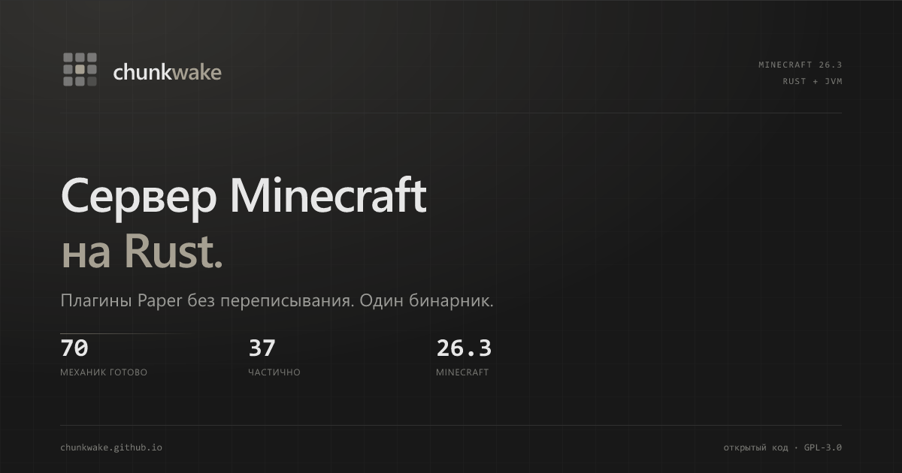
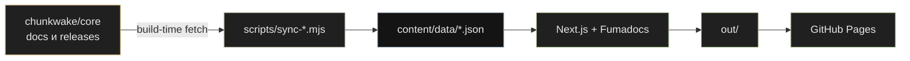

<div align="center">

<a href="https://chunkwake.github.io/ru/"></a>

# chunkwake.github.io

**Сайт проекта Chunkwake: документация, эксплуатация, справочник команд,<br>
замеры, статус разработки и страница загрузки.**

[](https://github.com/chunkwake/chunkwake.github.io/actions/workflows/site.yml)
[](https://nextjs.org)
[](https://fumadocs.dev)
[](https://www.typescriptlang.org)
[](https://nextjs.org/docs/app/guides/static-exports)
[](#контент)
[](https://github.com/chunkwake/core/blob/ver/26.3/LICENSE)

[Сайт](https://chunkwake.github.io/ru/) ·
[Документация](https://chunkwake.github.io/ru/docs/) ·
[Справочник команд](https://chunkwake.github.io/ru/docs/commands/) ·
[Замеры](https://chunkwake.github.io/ru/benchmarks/) ·
[Статус](https://chunkwake.github.io/ru/status/) ·
[Ядро](https://github.com/chunkwake/core) ·
[English](#english)

<a href="https://chunkwake.github.io/ru/">
  
</a>

<sub><a href="https://chunkwake.github.io/ru/">chunkwake.github.io</a> · статический экспорт · GitHub Pages</sub>

</div>

---

> [!WARNING]
> **Сайт документирует раннюю стадию.** Chunkwake уже запускает выживание с генерацией мира, редстоуном, мобами и плагинами Paper, но это ещё не замена Paper на живом сервере. Источник истины — [`chunkwake/core`](https://github.com/chunkwake/core) и [фич-матрица](https://chunkwake.github.io/ru/docs/feature-matrix/). Если сайт и core расходятся, верьте core. Делайте резервные копии миров.

## Что это

Отдельный репозиторий сайта, не часть Rust-ядра. Здесь живут:

- публичная документация на русском и английском;
- справочник реализованных команд с поиском и уровнями прав;
- страница эксплуатации: systemd, логи, бэкапы, Velocity;
- наблюдаемость: дашборд, `/top`, Prometheus, профиль тика;
- интерактивная фич-матрица и миграционный чеклист;
- страница замеров с методикой и сырыми числами;
- статус и этапы разработки;
- загрузка из GitHub Releases и поддержка проекта.

Сайт собирается в статику и публикуется на GitHub Pages. Серверной части, базы данных и пользовательских аккаунтов нет.

## Что внутри

| Страница | Что там |
|---|---|
| [`/ru/`](https://chunkwake.github.io/ru/) | лендинг: архитектура, совместимость, замеры, плагины |
| [`/ru/docs/`](https://chunkwake.github.io/ru/docs/) | вход в документацию |
| [`/ru/docs/running/`](https://chunkwake.github.io/ru/docs/running/) | первый запуск, конфигурация, systemd, логи, бэкапы, Velocity |
| [`/ru/docs/commands/`](https://chunkwake.github.io/ru/docs/commands/) | 73 команды ядра, поиск, фильтры, отличия от ванили |
| [`/ru/docs/observability/`](https://chunkwake.github.io/ru/docs/observability/) | дашборд, `/top`, `chunkwake top`, Prometheus, профиль тика |
| [`/ru/docs/migrating/`](https://chunkwake.github.io/ru/docs/migrating/) | миграция с Paper/Folia, Docker и интерактивный чеклист |
| [`/ru/docs/feature-matrix/`](https://chunkwake.github.io/ru/docs/feature-matrix/) | матрица механик, синхронизируется из core |
| [`/ru/benchmarks/`](https://chunkwake.github.io/ru/benchmarks/) | железо, методика, таблицы, оговорки, воспроизведение |
| [`/ru/status/`](https://chunkwake.github.io/ru/status/) | этапы M0–M10, текущий фокус, исследовательские направления |
| [`/ru/download/`](https://chunkwake.github.io/ru/download/) | релизы, платформы, размеры, SHA-256 |
| [`/ru/support/`](https://chunkwake.github.io/ru/support/) | поддержка криптовалютой, без подписок и аккаунтов |

Английские версии — те же маршруты с `/en/`.

### Возможности сайта

- **RU / EN** — русский базовый, английский через суффикс `.en`.
- **Поиск по всему сайту** — документация, команды, бенчмарки, загрузка, поддержка и статус.
- **Фич-матрица** — список и доска, поиск, фильтры, детали с заметками.
- **Справочник команд** — поиск, фильтры по разделам и уровням прав, отметки расширений Chunkwake.
- **Чеклист миграции** — 20 пунктов с сохранением в `localStorage`.
- **Загрузка из Releases** — платформы, размеры и SHA-256 из GitHub API.
- **PWA и OG** — манифест, иконки, картинки для соцсетей.
- **Яндекс Метрика** — только в production, с отслеживанием SPA-переходов.

## Быстрый старт

Нужны **Node.js 22+** и **pnpm 10+**.

```bash
pnpm install
pnpm dev          # http://localhost:8500
```

`predev` синхронизирует матрицу, даты документации и релизы. `prebuild` делает то же самое и дополнительно собирает OG-картинки и PWA-иконки. Если сеть недоступна, используется последняя сохранённая копия.

### Проверка перед PR

```bash
pnpm types:check  # next typegen + tsc --noEmit
pnpm build        # статика в out/, кастомный 404 и .nojekyll
pnpm preview      # http://localhost:8500 поверх out/
```

Полезные команды:

```bash
pnpm sync:matrix     # feature-matrix.md → content/data/feature-matrix.json
pnpm sync:docs       # даты последних изменений docs
pnpm sync:release    # последний GitHub Release → content/data/release.json
pnpm images:generate # OG-картинки и PWA-иконки
```

## Стек

| Слой | Что используется |
|---|---|
| Фреймворк | Next.js 16, App Router, `output: 'export'` |
| Документация | Fumadocs 16, MDX, Shiki |
| UI | React 19, Tailwind CSS 4, собственные CSS-компоненты |
| Диаграммы | `@xyflow/react` |
| Поиск | `zbsearch` через статический индекс Fumadocs |
| Картинки | `@resvg/resvg-js` |
| QR | `qrcode` |
| Пакеты | pnpm 10 |
| Деплой | GitHub Actions → GitHub Pages artifact |

## Структура

```text
app/
├── (root)/                 / → /ru/ и глобальная 404
├── [lang]/(site)/          лендинг, benchmarks, status, download, support
├── [lang]/docs/            документация Fumadocs
└── api/search/             статический поисковый индекс

components/
├── landing/                секции лендинга
├── feature-matrix.tsx      матрица: список, доска, фильтры
├── commands-reference.tsx  поиск и фильтры команд
├── migration-checklist.tsx чеклист с localStorage
├── benchmark-report.tsx    страница замеров
├── status-report.tsx       этапы и текущий фокус
├── download-panel.tsx      релизы, платформы, SHA-256
├── search.tsx              клиент статического поиска
└── mdx.tsx                 компоненты, доступные в MDX

content/
├── docs/                   MDX: русский базовый, английский .en.mdx
│   ├── meta.json           дерево RU
│   └── meta.en.json        дерево EN
└── data/                   сгенерированные и кэшированные JSON

lib/
├── source.ts               источник документации
├── i18n.ts                 локали ru/en
├── dictionary.ts           тексты лендинга и страниц
├── benchmarks.ts           данные бенчмарк-лаборатории
├── milestones.ts           этапы, состояния и счётчики
├── release.ts              типы и форматирование релизов
└── search-pages.ts         статические страницы в поисковом индексе

scripts/
├── sync-feature-matrix.mjs синхронизация фич-матрицы
├── sync-docs-meta.mjs      даты изменения документации
├── sync-releases.mjs       GitHub Releases и SHA-256
├── generate-images.mjs     OG и PWA-иконки
└── postbuild.mjs           404.html и .nojekyll

public/                     favicon, иконки, OG-картинки, 404
source.config.ts            тема Shiki для MDX
next.config.mjs             static export, trailing slash, images
```

## Контент

### Документация

Русские страницы лежат в `content/docs/*.mdx`, английские — в `*.en.mdx`.

Новую страницу нужно добавить в оба дерева:

- `content/docs/meta.json` — русское название раздела;
- `content/docs/meta.en.json` — английское.

Fumadocs собирает из этого боковую панель, хлебные крошки, поиск и навигацию «назад/далее».

Страницы верхнего уровня:

- `getting-started` — быстрый старт;
- `running` — эксплуатация;
- `commands` — справочник команд;
- `observability` — метрики и дашборд;
- `migrating` — миграция;
- `feature-matrix` — фич-матрица;
- `plugins` — разработка плагинов;
- `architecture` — устройство ядра;
- `faq` — вопросы и ответы.

### MDX-компоненты

Компоненты, доступные без импорта, регистрируются в `components/mdx.tsx`:

- `FeatureMatrix` — интерактивная матрица;
- `CommandsReference` — справочник команд;
- `MigrationChecklist` — чеклист миграции;
- `MatrixTotals` — сводка по матрице;
- `LangIcon` — иконка языка.

Новый компонент сначала добавьте в `getMDXComponents()`, потом используйте в MDX.

### Правила текста

- Коротко и по делу, без AI-филлера и канцелярита.
- Не выдумывать числа и поведение: источник — core, `docs/perf.md`, `docs/commands.md`.
- Указывать ограничения и раннюю стадию, если механика не готова.
- Не добавлять подписки, аккаунты и платёжные формы. Поддержка — только криптовалюта.
- Не использовать военную лексику и неформальные сокращения.
- Сохранять паритет RU/EN: если меняется страница, меняется и её перевод.
- Комментарии, документация и сообщения коммитов — на русском.

## Данные и синхронизация



| Скрипт | Что делает | Fallback |
|---|---|---|
| `sync-feature-matrix.mjs` | тянет `core/docs/feature-matrix.md`, разбирает таблицы в JSON | последний `content/data/feature-matrix.json` |
| `sync-docs-meta.mjs` | собирает даты последних изменений MDX | mtime файла |
| `sync-releases.mjs` | берёт последний Release, ассеты, размеры, SHA-256 из `digest` или `SHA256SUMS` | последний `content/data/release.json` |
| `generate-images.mjs` | рисует OG-картинки и PWA-иконки | уже готовые файлы в `public/` |
| `postbuild.mjs` | копирует `404.html` и создаёт `.nojekyll` | — |

В dev-режиме скрипты запускаются с `--cache`, чтобы не дёргать GitHub на каждый перезапуск. В CI используется `GITHUB_TOKEN`, чтобы снизить риск rate limit.

## Поиск

Поиск работает **полностью в браузере**:

1. `/api/search` отдаёт статический индекс.
2. `components/search.tsx` использует `useStaticSearch` из Fumadocs.
3. Индекс загружается один раз, запросы выполняются локально.

> [!IMPORTANT]
> В статическом экспорте нельзя использовать серверный `useFetchSearch`: `/api/search?query=...` вернёт весь индекс, а не результаты. Клиент должен быть на `useStaticSearch`.

`app/api/search/route.ts` собирает индекс из двух источников:

- всех страниц документации;
- статических страниц сайта: главная, бенчмарки, загрузка, поддержка, статус.

Поэтому глобальный поиск находит не только документацию, но и, например, `Ryzen`, `USDT` или `M7`.

## Дизайн

Тёмная тема, без переключателя. Палитра:

| Цвет | Роль |
|---|---|
| `#181818` | фон |
| `#202020` | панели и карточки |
| `#303030` | границы |
| `#A6A092` | акцент |
| `#E7E7E7` | основной текст |
| `#9DB283` | готово / успех |
| `#C7A96B` | частично / предупреждение |
| `#C77E72` | ошибка |
| `#8FA3B8` | информация |

Основные стили — в `app/global.css`. Компоненты не тянут UI-кит: кнопки, карточки, таблицы, тулбары и адаптивность описаны рядом с остальной темой. Брейкпоинты — `1060px`, `860px`, `560px`.

## Деплой

Workflow [`.github/workflows/site.yml`](.github/workflows/site.yml):

1. Ставит pnpm и Node 22.
2. Выполняет `pnpm build`.
3. Загружает `out/` как GitHub Pages artifact.
4. Публикует через `actions/deploy-pages`.

Ветка `gh-pages` не используется. В настройках репозитория:

**Settings → Pages → Build and deployment → Source: GitHub Actions.**

Репозиторий называется `chunkwake.github.io`, поэтому сайт живёт в корне домена и `basePath` не нужен.

Workflow также запускается:

- по расписанию — чтобы обновлять фич-матрицу;
- по `repository_dispatch` типа `core-docs` и `release`.

## Проверка перед релизом

Автоматически:

```bash
pnpm types:check
pnpm build
```

Вручную:

- открыть RU и EN версии новых страниц;
- проверить поиск на собранной статике, а не только в dev;
- пройти по ссылкам из документации и футера;
- проверить пустое состояние загрузки, если релиза ещё нет;
- проверить чеклист миграции после перезагрузки;
- убедиться, что Метрика не грузится в dev;
- проверить мобильную ширину 360–390 px.

## Участие

Pull request'ы и issue приветствуются.

- Один PR — одна тема.
- Для новой страницы обновите `meta.json`, `meta.en.json`, `app/sitemap.ts` и ссылки в индексе документации.
- Если данные берутся из core, добавьте кэш и fallback.
- Не коммитьте секреты, токены и реальные адреса почты.
- Не добавляйте аккаунты, подписки и оплату картой.
- Если нашли расхождение с core, приложите ссылку на исходный документ или строку кода.

Нашли ошибку на сайте — [откройте issue](https://github.com/chunkwake/chunkwake.github.io/issues) с URL, языком и шагами.

## Что дальше

- релизный workflow в core: тег → архивы → `SHA256SUMS` → GitHub Release;
- синхронизация оставшихся `core/docs` в MDX на сборке;
- каталог совместимости плагинов;
- changelog из GitHub Releases;
- больше целей Метрики: загрузки, переходы в GitHub, поиск команд.

## Лицензия

Проект Chunkwake распространяется под [GNU GPL v3](https://github.com/chunkwake/core/blob/ver/26.3/LICENSE).

Chunkwake — независимый проект. Он не связан с Mojang Studios, Microsoft, PaperMC или Folia и не одобрен ими. Minecraft — товарный знак Mojang Synergies AB.

---

## English

**chunkwake.github.io** is the static site for **Chunkwake**, a Minecraft Java Edition 26.3 server written in Rust. It contains the public documentation, command reference, operations and observability guides, benchmarks, development status and downloads.

- **Stack:** Next.js 16, Fumadocs 16, React 19, TypeScript, Tailwind CSS 4.
- **Output:** static export, deployed to GitHub Pages through Actions.
- **Languages:** Russian is the default, English lives under `/en/`.
- **Search:** fully client-side over a static index; no search server.
- **Data:** the feature matrix and GitHub Releases are synced at build time with a cached fallback.
- **No backend:** no accounts, databases, subscriptions or payment forms.

```bash
pnpm install
pnpm dev          # http://localhost:8500
pnpm types:check
pnpm build
```

Live site: <https://chunkwake.github.io/> · Core: <https://github.com/chunkwake/core>

Docs and commit messages are in Russian; issues and PRs in English are welcome.
